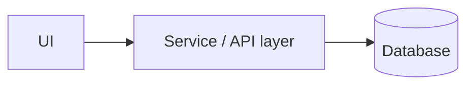
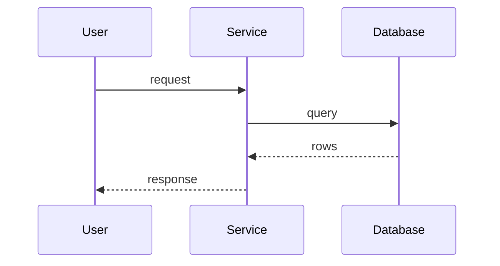

# Architecture

> Agents read this instead of scanning the whole codebase. Keep it accurate and terse.
> **Don't edit this on a feature branch.** `sync-docs` writes to `docs/changes/<branch>.md`;
> `consolidate-docs` folds those fragments in here. Check `docs/changes/` for newer impact rows.

## Overview

<!-- TODO(project): 2–4 sentences. What the system does and its main parts. -->

## Components

<!-- TODO(project): Replace with real components. -->

## Modules

| Module | Path | Responsibility | Depends on |
| ------ | ---- | -------------- | ---------- |
| <!-- TODO(project) --> | | | |

## Key flows

Sequence diagrams for the 2–5 most important execution paths (call chains).

<!-- TODO(project): Replace with a real flow. -->

## Change impact map

**"If you change X, also check Y."** The most important section in this file.

Add a row whenever:

- a change in one place broke something somewhere else, or
- two parts are coupled in a way that isn't obvious from imports (shared names,
  config keys, column order, file formats, env vars, etc.).

| If you change… | Also check / update… | Why | Guarded by test |
| -------------- | -------------------- | --- | --------------- |
| _Example: a DB table's columns_ | _Serializers, migrations, `docs` schema section_ | _Serializers map columns by name_ | _`tests/test_serializers`_ |

## Data

<!-- TODO(project): Database choice, where the schema/migrations live, key tables. -->
