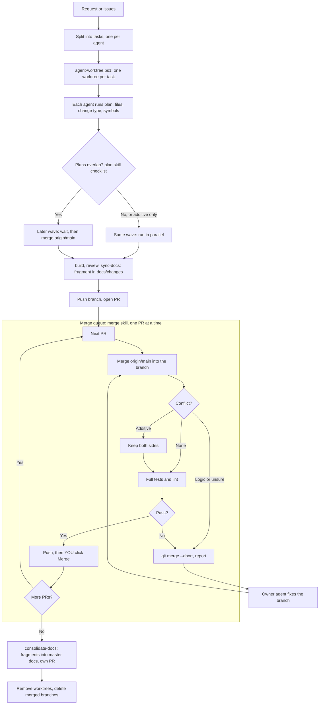

# Workflow

How work flows from a request to `main`, with one agent or several.
Reasoning: [ADR 0001](adr/0001-parallel-agents-workflow.md).

## One agent

`plan` -> (approve) -> `build` -> `review` -> `sync-docs` -> push and open a PR -> **you merge**.

Fragments pile up in `docs/changes/`. Run `consolidate-docs` whenever you like,
e.g. weekly or when the folder gets busy.

## Two or three agents

### Steps

1. **Split** the work into tasks that are as independent as possible (separate
   features or modules).
2. **Create a worktree per task** and open each in its own IDE window:
   `.\scripts\agent-worktree.ps1 -Name <issue#>-<name>`.
3. **Plan.** Each agent runs `plan` and stops. Then ask one agent (or do it
   yourself): "compare these plans", which applies the checklist in the `plan`
   skill and returns waves.
4. **Build.** Approve wave 1. Later waves wait; when they start, they merge
   `origin/main` first (the `build` skill says so).
5. **PRs.** Each agent pushes and opens a PR.
6. **Merge queue.** Ask an agent to run `merge` on the open PRs. It prepares one PR
   at a time; you click Merge; it moves to the next.
7. **Consolidate** docs with `consolidate-docs` (its own PR), then clean up worktrees.

## Who does what

| Step | Who |
| ---- | --- |
| Split tasks, approve plans and waves | You (or an agent you ask to compare plans) |
| Plan, build, review, write fragment | Each feature agent, in its own worktree |
| Bring PRs up to date, resolve additive conflicts | Merge agent (`merge` skill) |
| Click **Merge** on GitHub | **Always you** |
| Fold fragments into master docs | Any agent (`consolidate-docs` skill), via PR |

## Rules of thumb

- **Once a branch is merged, it's done.** Start a new branch for follow-up work.
  Reusing a merged branch can conflict when its fragment has been consolidated.
- **Merge, don't rebase.** Merging `origin/main` into a branch catches the same
  conflicts without rewriting history or force-pushing. On GitHub, the PR's
  **Update branch** button does the same thing.
- **Small PRs, merged soon.** Old branches collect conflicts.
- **Lockfiles:** never hand-merge; take main's version and re-run install.
